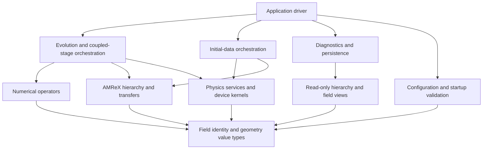

# AMReX infrastructure and maintainability audit

Date: 2026-09-07. Cycle 400. Status: completed architecture audit; implementation proposed, not applied.

The principal problem is incomplete ownership boundaries. There are already useful
catalogs, compiled services, numerical controls, and detailed conventions. However,
the AMR class still coordinates and owns many unrelated concerns, build targets
mostly enforce compilation reuse rather than subsystem isolation, and the Python
workflow has become a second large application with weak module boundaries.

Two workflow defects were reproduced during this audit: quoted input values are
misinterpreted by reporting, and a default run can delete its own restart source.
These should precede structural refactoring. Existing passing architecture/build
checks do not establish that these runtime workflows are sound.

## Scope, evidence, and limits

The audit covers the organization and infrastructure of the whole `pyfluid_amrex`
tree, including relativistic extensions. It does not rederive every physical
equation or certify every supported simulation. Python/JAX and Numba solver
implementations are outside scope; their shared environment affects AMReX tooling
and is included for that reason.

The inspected checkout is based on `547c93a7d5b2cf0fcb54d76e1c0af22e848bd43b`, with
substantial pre-existing tracked and untracked changes. That commit alone does
not identify the inspected source. The audit inventory records SHA-256 hashes.

Evidence is under `runs/current/infrastructure_audit/cycle400/`:

- `inventory.tsv`: all 704 non-cache files present before this report, with hashes,
  sizes, and classification. Generated files account for 41 entries.
- `include_impact.tsv`: transitive project-header reachability. This includes all
  literal preprocessor branches; it is an upper bound, not a measured rebuild.
- `python_symbols.tsv`, `python_imports.tsv`: Python structural inventory.
- `gates.tsv`: current suite entry points and exact commands.
- `probes.txt`: results from disposable configuration/restart reproductions.
- `git_head.txt`, `git_status.txt`: initial checkout context.

Every file was inventoried; semantic review followed subsystem entry points,
public contracts, shared lifecycle code, dependency paths, and representative
consumers/tests. An inventory entry does not mean line-by-line semantic review.
Generated algebra was considered through its owning sources and interfaces.
Bundled numerical tables were inventoried and their provenance mechanism read;
their individual data values were not independently scientifically validated.

| Area | Files / lines, excluding generated directories | Review focus |
| --- | ---: | --- |
| C++ implementation `src/` | 129 / 68,103 | Driver, AMR lifecycle, numerics, physics, EoS, ID, persistence |
| Public `include/` | 140 / 36,229 | Contract size, transitive dependencies, storage/views, host/device separation |
| Code generation | 32 / 13,131 | Symbolic ownership, schema loading, emission and build dependencies |
| Tools | 131 / 59,711 | Execution, reporting, plotting/readers, validation, build and machine management |
| Tests | 20 / 17,740 | Behavioral versus structural checks, suite integration and consolidation candidates |
| Inputs | 154 / 9,005 | Configuration/artifact contract; inventory, not execution of every example |
| Topic documentation | 13 / 5,452 | Ownership guidance, extension instructions and information duplication |
| Schemas | 5 / 3,536 | Field, diagnostic, method, numerical and physical-ID identity |
| EoS resources | 25 / 2,147 | Provenance manifests, loader boundaries and independent reference resources |

Additional reviewed areas: CMake/presets, machine profiles, dependency pin/manager,
benchmark entry points, reference-data routing, root Python dependency manifest,
and continuity files. Local host-install scripts were read as optional machine
tooling; no installer or privileged operation was executed.

Fresh checks: architecture passes; the existing 16 build-infrastructure tests pass
in 5.377 seconds. Their temporary CMake fixture builds are not a production build.
The two workflow probes ran without MPI or the solver. No production rebuild,
standard numerical suite, GPU run, scaling run, or performance benchmark was
performed. No production source, tests, inputs, or enforced conventions changed.

## Findings, ordered by practical priority

Priorities describe implementation order, not vulnerability severity. “Confirmed”
means reproduced or directly demonstrated in source. “Design gap” identifies an
extension/reliability risk; it does not claim an observed wrong simulation.

### 1. The runner can erase its own restart input — first fix, confirmed

`tools/run_case.py:127` reads the input, resolves the output directory, and cleans
that directory before launch. It preserves the input file if it lies underneath
the output directory, but does not protect `pyfluid.restart_file` or an imported
initial-data artifact there. `safe_clean_run_dir` protects locations outside
`runs/`, not dependencies inside the selected run.

A disposable fixture with `restart_file = <output>/checkpoints/chk00010` was
deleted before a mocked launch. No real run data was touched. `--keep-existing`
avoids cleaning but depends on the caller knowing this hidden obligation.

Give the execution layer a preflight that resolves input dependencies before
cleaning. Reject an overlapping cleanup target with a precise explanation, or
use an explicitly designed restart/output policy. Do not silently copy large
checkpoints or rely on callers remembering a flag. The same preflight should
check executable/input availability before destroying an existing run directory.

### 2. C++ input semantics and Python interpretation disagree — first fix, confirmed

Implementation update (Cycle 402): the shared input reader now separates decoded
values from serialized assignments; reporting and generated-input round trips
are checked. Runner preflight also addresses Finding 1's nested-input cleanup
failure, including symlinks and missing read dependencies. Three focused workflow
tests, an 860-file compatibility probe, the existing quick gate, and two actual
runner launches passed. This does not resolve binary provenance or the broader
ownership findings. The evidence below records the original defect.

`tools/validation_common.py:608` splits at `#` and `=`, retaining surrounding
quotes. Consumers compare the resulting strings directly. The probe gives
`none -> closed` but `"none" -> diffusive`; explicit `"closed"` raises an unknown
policy error. The parser also cannot correctly handle a `#` inside a quoted
string. `run_case.py:23` uses the unprocessed string as an output path.

Define one supported interpretation of canonical `run.in` for Python consumers.
Separate decoded values used for decisions from serialized tokens used to write
an input. A blanket `strip('"')` risks corrupting string semantics and generated
inputs. Keep AMReX as the solver parser; a small shared reader for its supported
canonical output is preferable to inventing another configuration language.

The scope extends beyond scalar policy: physics hooks, output paths, boundary
classification and restart workflows all consume this reader. Reuse one compact
round-trip/workflow test group when fixing it. Do not add a separate quote test
to every consumer. The current closed/diffusive scalar policies happen to share
checks; that limits this particular symptom, not the broader parser defect.

### 3. The AMR driver remains a common owner for too much state — high, confirmed structure

Implementation update (Cycle 403): regrid bookkeeping is now one private-state
`RegridLifecycle` owner, compiled once in a standard-library-only static target.
Nine scattered fields and three solver tracking methods were removed. Existing
moving-AMR scalar histories/regrid counts match before and after; aligned restart
matches uninterrupted checkpoints exactly. A forced-cold owner compile takes
0.34 s and all-dimension relinking 0.98 s, with no driver recompilation. This is
one completed boundary; gravity, CT, coupling caches and diagnostics below still
need their own ownership review. See Cycle 403 for validation limits and logs.

`src/amr/amr_solver_base.hpp:633` holds configuration, initial-data providers,
horizon tracking, fluid/spacetime state, coupling caches, primitive/flux scratch,
CT fields, gravity storage, solid masks, conservation ledgers, regrid counters,
diagnostic references and physical-ID summaries. Its methods share protected
access. `amr_solver_internal.hpp:62` includes twelve implementation fragments
inside the derived class; the base includes two more.

Consequently, splitting `.cpp` files has limited who compiles some code but has
not limited who can depend on or mutate those members. The base header reaches
27 production `.cpp` consumers in the conservative include graph.

Extract ownership incrementally: output/diagnostic services, gravity state,
magnetic state/register lifecycle, and physical-ID services are plausible seams.
Keep `AmrCore` hierarchy callbacks together. Pass explicit views/context into
services, not the entire solver or a replacement “everything context.” Avoid
another deep inheritance tree. Each extraction must remove the old ownership.

### 4. Stage and hierarchy validity are largely caller obligations — high, design gap

Implementation update (Cycle 404): `GravityFields` owns potential/gradient
allocation, fixed-cache validity and Poisson setup. Consumers obtain const field
pointers; they cannot replace storage or write cached fields through this API.
Density/RHS preparation is compiled in the hierarchy driver, while stage source
and energy-register operations remain with the integrator. This preserves the
existing cache policy; it is not a general stage-generation validity system.

`solver_sections/subcycling.inc.hpp:4` manually sequences old-time updates,
boundary fills, state copies, CT accumulation, diffusion, recovery and accepted
state validation. `time_integrators.inc.hpp:4` has separate direct-flux/general
paths and multiple stage-specific fill/source sequences. These paths have real
performance and numerical purposes; they are not automatically redundant.

`EvolutionSectorStorage` is a useful state owner, but exposes mutable vectors of
stage data. `SpacetimeCouplingStorage` has explicit cell-metric validity, while
many other caches and ghost obligations are implicit. A finite/physical check
does not prove a field belongs to the correct stage, grid generation or time.

Write the actual accepted-state and stage sequence first. Then introduce small
host-side contexts carrying level range, stage/time and hierarchy generation,
plus explicit invalidation at mutation/regrid/restart boundaries. Start with
the concrete caches involved; do not build a universal runtime task language.
Preserve CT stage weights, reflux accumulation, dense-time interpolation and
coupled-sector synchronization as one reviewed numerical contract.

### 5. CMake mostly describes source collections, not subsystem contracts — high, confirmed structure

`CMakeLists.txt:86` onward defines broad source lists, and `:719` gives compiled
targets both `include` and all of `src`. `cmake/PyFluidSharedObjects.cmake` later
rewrites target sources into shared per-file object owners when compatible
consumers reuse them. This saves compilation, but is a second mechanism that a
maintainer must understand and does not establish subsystem dependency direction.

Prefer a small set of explicit dimension-specific internal library targets with
private implementation headers and declared dependencies. Preserve method-local
flux objects and the isolated horizon library where they already provide useful
compile boundaries. Migrate one source family at a time and retire the matching
source-list/rewrite plumbing. Do not create one library per helper or sacrifice
focused check targets by linking every check to the entire application.

The sharing helper compares selected direct compile properties. Future target
specialization through transitive usage requirements should not assume those
comparisons prove full compile-context equivalence. This is a design caution,
not a demonstrated miscompile of current targets.

### 6. Broad configuration and geometry headers spread unrelated change — high, confirmed structure

`include/pyfluid_amrex/config.hpp` reaches 73 production `.cpp` files;
`mesh_geometry.hpp` reaches 83. The latter combines small enums/layout types with
inline host string parsing and validation. `fields.hpp` includes it, and
`config.hpp` includes both field and geometry contracts. These are transitive
source counts, not wall-time measurements.

Separate geometry value types/device views from host name parsing and validation.
Group configuration by actual subsystem, while preserving the input vocabulary.
Convert relevant selections into immutable typed operation parameters at setup.
Avoid handing a complete `RunConfig` to every low-level operation. Do not require
runtime polymorphism in pointwise kernels, and preserve measured fused kernels.

### 7. Validation results are not reliably tied to the compiled source state — high, confirmed gap

`validation_common.py:300` launches the selected executable. The feature matrix
checks that it exists, but does not bring it up to date. Some other validators
build focused targets themselves. Thus “force rerun” and “build current source”
have inconsistent ownership and are different actions.

`capture_baseline_run.py:103` records branch, short HEAD and `git status --short`,
but those do not identify the contents of dirty/untracked files or the actual
binary used. Two different dirty trees can have the same manifest identity.

Have the suite/run service own a clear build-or-use-existing policy once per
invocation. Record binary identity, build configuration/dependency identity,
input identity, and source provenance sufficient to distinguish dirty content.
Use hashes/manifests and a preserved patch/snapshot when a baseline must be
reconstructible; a hash alone cannot recover source. Do not rebuild separately
inside every child check. Until then, report build and run evidence separately.

### 8. Some architecture tests prescribe syntax rather than a useful boundary — medium, confirmed

`tests/test_build_infrastructure.py:26` checks exact qualifier/newline/function
spellings. It can fail after harmless formatting, while not measuring the
compile/runtime property that motivated it. `check_architecture.py:225` rejects
production `.cpp` files of at most twenty lines outside two selected directories.
The same tool globally rejects `*_impl.hpp` names and searches tokens in selected
headers. Such rules can obstruct an ordinary small implementation owner.

Retire the exact whitespace assertion and arbitrary short-file/name prohibitions
as part of the boundary migration. Preserve transitive dependency checks, unique
catalog identity, and the behavioral shared-object fixture until replaced by
explicit targets. Use existing compile/runtime benchmarks for performance
contracts. File size and naming can guide review without becoming pass/fail laws.

This audit did not establish that most tests are redundant. The 55 standard
entries have no exact duplicate command tuples. That does not prove unique
behavioral coverage either: nested validators and overlapping physical controls
require an oracle/contract comparison before deletion.

### 9. Python tools need ordinary package boundaries — high, confirmed structure

`validation_common.py` owns process groups, build invocation, input parsing,
scalar policy, TSV I/O and history. Shared reporting calls validation-script
functions: `postprocess_common.py:188` imports causal/isotropy validators, while
plotting imports reference routines from `validate_rmhd.py`. Several validators
import `validate_black_hole.py`. These are working imports, but reverse the
intended dependency between reusable functionality and command-line entry points.

The AST inventory finds a 1,521-line `main` in
`tools/validate_equilibrium_torus.py:488`. Long declarative case lists are not
equivalent to such mixed procedural orchestration and should not receive the
same automatic treatment.

Create a small importable support package for execution, run data, scalar policy,
reference calculations and reporting. Existing scripts become thin CLI clients;
scientific cases remain readable declarations with topic-specific analysis.
Move reusable functions out of validators, then remove superseded helpers.
Two exact duplicated function bodies were found: `medley_profile` in the
advection/characteristic medley tools, and `shell_axis_and_sign` in two plotters.
These are concrete consolidation candidates, not evidence that their tests or
plots should be removed.

### 10. Initial-data orchestration crosses several responsibilities — medium/high, confirmed structure

`initial_data_materialization.cpp` is 3,713 lines, `physical_id.cpp` 3,686.
Materialization contains continuation scheduling, coupled iteration, convergence
assessment and object summaries. `initial_data/materialization.hpp:75` already
has a useful observer boundary. `amr_solver_levels.cpp:20` also performs
diagnostic-region and black-hole symmetry policy checks; level lifecycle is not
its only concern.

Separate artifact serialization, native solve/continuation, sampling/centering
transfer, and composition policy behind existing compiled interfaces. Keep
coupled constraints in the appropriate orchestrator rather than pretending each
object can solve independently. Move physics-specific startup validation to its
owner, invoked explicitly once geometry is available. Preserve current nonlinear
and cross-grid controls; do not rewrite algorithms while reorganizing them.

### 11. Checkpoint and output publication have weaker completion semantics than their readers — medium, confirmed source

`src/framework/checkpoint.cpp:982` creates the final hierarchy and writes Header
and metadata before all HDF5 fields complete. The reader performs extensive
compatibility checks, which is good, but a visible directory/header is not proof
of a completed checkpoint. No interrupted-write experiment was performed.
`src/amr/output.hpp:70` and `:89` silently return when metadata fallback/native
header opening fails; this previously deferred finding remains present.

Define when an artifact becomes discoverable as complete. A staging directory
and final publication, or a completion marker after collective success, is a
candidate; choose with actual filesystem/MPI semantics in mind. Check final
stream/write outcomes, and propagate output failure clearly. Consolidate repeated
HDF5 opening/closing and box decoding where that removes actual duplication,
without replacing AMReX's collective data path with a generic serialization system.

### 12. Generated ownership is valuable, but generation/build plumbing is spread out — medium, confirmed structure

Five TOML schemas, strict loaders, symbolic equations and generated C++/JSON are
strong foundations. `physical_system.py` expresses coordinate-independent laws;
the generated field catalog is already consumed by output labels and storage.
Retain this architecture.

Output paths/families and dependencies are repeated across
`codegen/generate_kernels.py`, emitters and CMake custom commands. Generated files
are written into the source tree, shared by build configurations. Emission checks
unchanged content, which protects no-op builds, but independent builds still
share ownership of those paths. No concurrent-generation corruption was reproduced.

Give generated artifact layout one explicit build contract. Assess build-local
outputs versus an explicitly owned checked-in generation step, including tooling
that reads generated JSON without compiling. Keep the choice simple; do not add
a second build executor or a schema language for physical algorithms.

### 13. Conventions and continuity exceed a practical entry-point size — high for maintainability

Before this report, `knowledge.md` had 1,781 lines,
`docs/infrastructure_conventions.md` 1,005, code conventions 288, and the running
cycle file over 10,000. Infrastructure conventions contain extensive
physics/initial-data detail. Root instructions still describe a Newtonian solver
and say to keep initial data in `pyfluid/initial_data.py`, whereas production C++
initial data and relativity are extensive. That instruction is no longer an
adequate routing rule for this backend.

Replace the required entry path with a short current architecture/ownership map,
the active task record and linked topic documents. Archive completed history
without destroying provenance. Keep incident-specific numerical lessons beside
the responsible subsystem. Consolidate contradictions and duplicated rules;
do not make this audit another mandatory document for every future edit.

### 14. Tool installation and portability concerns are mixed into the default environment — medium

Root `pyproject.toml` makes JAX, Numba, notebooks and plotting dependencies part
of the same environment used for AMReX code generation. Local profiles and presets
correctly isolate many Apple/MPI choices, and the AMReX manager pins an official
commit and activates installations separately from solver builds.

Use dependency groups for AMReX generation, reporting and optional reference/
notebook work. Keep host counters/installers and machine scheduling outside the
numerical modules. Preserve the current dependency manager's pin, verification
and rollback behavior. No additional dependency manager or automatic installation
is proposed. A portable build profile and warning/sanitizer configuration should
be considered during build cleanup, not turned into an immediate platform matrix.

### 15. History ownership assumes serialized writers — lower priority, design gap

`validation_common.py:1115` reads the header, may rename a legacy history, appends
rows, and rewrites the recent mirror without interprocess coordination. Sequential
suite use is consistent with this; independently concurrent runs have no explicit
writer contract. This audit did not reproduce lost rows.

Either declare one aggregator the writer or add narrow atomic/locking behavior
when parallel run support is required. Do not introduce a database solely for
compact local history. Stable overwritten run artifacts and compact rolling
history remain useful conventions.

### 16. Restart equivalence does not validate scalar budgets — high, reproduced in Cycle 404

`tools/validate_amr.py:856` runs a checkpoint comparison without applying shared
scalar checks. The existing `self_gravity_deep_amr_subcycling` control, evaluated
separately with the existing self-gravity AMR scalar policy, has about 0.68%
energy drift and 2.434e-5 absolute momentum drift in its uninterrupted branch.
Its restart comparison also exceeds the 1e-12 field tolerance slightly
(1.233e-12). Rebuilding the exact pre-extraction source reproduces the same
per-level checkpoint differences and scalar histories; these are existing
failures, not accepted new tolerances.

The shorter feature-matrix self-gravity AMR/subcycling case independently fails
its 2e-6 energy tolerance at 2.244e-6 before and after extraction. Record restart
equivalence and scalar/physical validity separately, using the shared scalar
policy appropriate to each existing case. Numerical repairs remain open; do not
relax thresholds or call the entire gravity/AMR capability validated.

## What to retain

- Standard AMReX FillPatch, restriction and flux/edge-register conservation
  contracts; unique owned cells for production Cartesian multipatch evolution.
- One field/diagnostic identity, generated component/centering information and
  runtime conservation reductions. Avoid a second runtime field registry.
- Independent symbolic geometry checks plus discrete/numerical controls. One
  cannot replace the other.
- Hydro-only state sizing, shared coordinate-independent equations, and fused
  reconstruction/Riemann execution. A readability refactor must preserve these.
- Compiled EoS storage with small device views; compiled horizon/surface services;
  interpolation plans separate from sampled field storage.
- Machine profiles, centralized MPI process ownership and pinned dependencies.
- Solver-authored canonical inputs, strict restart compatibility, and explicitly
  documented physical support limits, after fixing workflow interpretation.

## Lessons from other codes

These are specific patterns, not endorsements of entire architectures.

| Reference | Evidence inspected | Adopt in PyFluid | Avoid copying automatically |
| --- | --- | --- | --- |
| Cactus/ETK | Official thorn interfaces, parameters and schedules | Explicit provided/required interfaces and lifecycle phases | CCL parser, thorn discovery, pervasive string registration |
| CarpetX/SpacetimeX | Local ODESolvers/Z4c schedules and CarpetX validity clauses | Read/write region obligations, ghost validity, post-regrid/restart phases | A full scheduling framework before ordinary C++ ownership is established |
| AthenaK | Local driver/CMake and pinned upstream hydro task assembly | Readable stage sequence and physics-owned operations | Its entire task runtime, public mutable members, or separate physical implementations |
| GRChombo / GRTeclyn | Pinned level interfaces, GRTeclyn BinaryBH implementation and official structure documentation | Clear problem/shared-code/backend layers; explicit AMReX lifecycle hooks | A growing inherited solver base, example-specific headers inside generic infrastructure, or duplicated field enums |
| SpECTRE | Official DataBox/build documentation and pinned GRMHD CMake target | Declared data dependencies and cache invalidation; named libraries with explicit dependencies | Charm++ migration or pervasive compile-time machinery without measuring build and comprehension costs |
| NRPy | Official repository layout and pinned C-function registration implementation | Separate mathematical equations, backend lowering and artifact emission | Another global registry or wholesale generator replacement |
| AMReX | Official AmrCore/FillPatch/FluxRegister documentation | Keep mesh lifecycle and conservative synchronization grounded in existing APIs | A second AMR abstraction that obscures required callbacks and timing |
| Parthenon | Official package/state/metadata documentation | Separation of field declaration, allocation, stage storage and requirements | Replacing AMReX or duplicating PyFluid's existing field catalogs |

Cactus documents interface, parameter and schedule declarations as separate thorn
contracts: [Cactus application thorns](https://www.cactuscode.org/documentation/usersguide/UsersGuidech9.html).
AMReX documents the five hierarchy callbacks and the roles of FillPatch and
flux registers: [AmrCore details](https://amrex-codes.github.io/amrex/docs_html/AmrCore.html).
Parthenon separates field registration from allocation and expresses provider/
requirement metadata: [state management](https://parthenon-hpc-lab.github.io/parthenon/v0.8.0/src/interface/state.html),
[metadata](https://parthenon-hpc-lab.github.io/parthenon/develop/src/interface/metadata.html).
These web pages were checked during this audit; development documentation can drift.

Local reference provenance:

- CarpetX checkout: `/Users/mrizzo/phys_research/ETK_CarpetX/CarpetX`, HEAD
  `2bb7f9bc10d7e0ba5657fb0e34cf779bbf2cdf81`. Inspected
  `CarpetX/interface.ccl`, `CarpetX/src/schedule.cxx:956`, and
  `ODESolvers/schedule.ccl`. This identifies HEAD, not a guarantee of a clean tree.
- SpacetimeX checkout: `/Users/mrizzo/phys_research/ETK_CarpetX/SpacetimeX`, HEAD
  `18d7bda1b7d8a208da596e113145df467afdfd9b`. Inspected `Z4c/schedule.ccl`,
  especially initial/post-regrid/RHS groups and region-qualified reads/writes.
- AthenaK local source: `/Users/mrizzo/phys_research/athenak/athenak/src/`,
  `driver/driver.hpp`, `hydro/hydro_tasks.cpp:46`, `CMakeLists.txt`. The local
  source directory did not provide a Git revision. File hashes are recorded in
  `external_sources.tsv`; findings refer to that local snapshot, not upstream HEAD.

AthenaK's inspected CMake still lists sources in one executable. It is evidence
for readable operational ownership, not evidence that many libraries alone
produce a maintainable solver. The recommended library boundaries below are an
inference from PyFluid's dependencies and extension needs.

### Broader NR comparison: concrete adaptations

**GRTeclyn is the closest additional reference.** It is the AMReX-based successor
to GRChombo. Its documented layers distinguish executable problem setup, shared
physics/infrastructure, and AMReX. That is a useful organization for PyFluid's
initial data, reusable numerical operators, and hierarchy ownership:
[GRTeclyn structure](https://grtlcollaboration.github.io/GRTeclyn/code_structure/).
The inspected [level interface](https://github.com/GRTLCollaboration/GRTeclyn/blob/8c543ac76521c360bcadfd2395339ece4b372cd6/Source/GRTeclynCore/GRAmrLevel.hpp)
and [BinaryBH implementation](https://github.com/GRTLCollaboration/GRTeclyn/blob/8c543ac76521c360bcadfd2395339ece4b372cd6/Examples/BinaryBH/BinaryBHLevel.cpp)
make initialization, RHS evaluation, tagging, restart and output hooks visible.
PyFluid should adopt these explicit lifecycle boundaries through small composed
services. Retain runtime configuration and the existing field schema; do not
require a new executable or handwritten variable enumeration for every case.
GRTeclyn's core header still includes example-supplied parameter/state headers,
so its layering is an example to assess, not a dependency design to copy verbatim.

**GRChombo helps identify what inheritance buys and costs.** Its
[GRAMRLevel interface](https://github.com/GRTLCollaboration/GRChombo/blob/37e659523830418b210acea1661dac0e00bb1b75/Source/GRChomboCore/GRAMRLevel.hpp)
exposes problem-specific hooks around a common evolution lifecycle. This makes
extension points discoverable, but inherited shared state and optional virtual
hooks can also accumulate obligations. PyFluid already has that pressure in
AmrSolverBase. Extract owners before introducing another hierarchy of base classes.

**SpECTRE provides a stronger model for dependency correctness.** DataBox declares
computed-data dependencies, caches results, and invalidates them after relevant
mutation. The transferable principle is that a cache's validity belongs to its
owner and dependency contract:
[DataBox overview](https://spectre-code.org/group__DataBoxGroup.html),
[mutation and compute tags](https://spectre-code.org/databox_foundations.html).
For PyFluid, an explicit state/stage/hierarchy revision attached to a small cache
owner is a candidate implementation; it needs to account for actual mutation
paths and GPU execution. A general compile-time container is not required.
SpECTRE's own [build profiling guide](https://spectre-code.org/build_profiling_and_optimization.html)
describes template instantiation costs. Its
[GRMHD library target](https://github.com/sxs-collaboration/spectre/blob/ded9388d069e2c70d034ed9f809907c07e9d2c1e/src/Evolution/Systems/GrMhd/ValenciaDivClean/CMakeLists.txt)
also demonstrates named subsystem libraries and declared public/private links.
Adapt this enforcement with narrow interfaces; the mere presence of a target
does not establish that its public dependency surface is small.

**AthenaK makes the timestep legible.** The pinned upstream
[hydro task assembly](https://github.com/IAS-Astrophysics/athenak/blob/df3f3b2cdb8aa4bb17e546aef63bbe7a7d86549f/src/hydro/hydro_tasks.cpp)
shows flux evaluation, communication, update, restriction, prolongation,
boundaries and primitive recovery as named operations with dependencies. PyFluid
should expose an equally readable stage sequence while preserving its own RK,
CT and coarse-fine ordering. The local and upstream snapshots have different
boundary/prolongation ordering; this is evidence against transplanting a task
sequence without checking the numerical contract.

**NRPy is relevant to generator organization.** Its
[repository](https://github.com/nrpy/nrpy) separates equations, infrastructures,
helpers and examples. PyFluid can similarly distinguish mathematical definitions,
discretization/backend lowering, and emission/build manifests. Its
[C-function model](https://github.com/nrpy/nrpy/blob/3db9070899ddc1f68a8839c1aae3f94aae414c7f/nrpy/c_function.py)
collects explicit function metadata, but also uses a global registration dictionary.
Prefer a generation context owned by each invocation for PyFluid, particularly
where dimensions and configurations may generate concurrently.

Together these suggest a coherent design: ETK-style declared obligations,
AthenaK-style visible sequencing, GRTeclyn-style AMReX lifecycle boundaries,
SpECTRE-style dependency-aware validity, and NRPy-style symbolic separation.
These are proposed adaptations, not demonstrated performance improvements.
Keep AMReX as the mesh backend and use ordinary C++ composition and internal
CMake targets to implement the boundaries. Each extraction should identify the
owner it establishes, the old code it removes, and the existing behavioral gate
that protects it. Add a test only for a distinct failure contract that those
gates do not already cover.

Cycle 401 source evidence is in
`runs/current/infrastructure_audit/cycle401/sources.tsv`: six source files from
five repositories, with commit IDs, original URLs and content hashes. Official
documentation supplements those pinned sources. Indexed GRTeclyn documentation
uses an older class spelling; the current pinned source determines filenames.

## Proposed ownership and dependency structure

Use ordinary internal CMake targets and C++ composition. The exact number/names
should follow extraction; these are responsibilities, not a request to scaffold
all targets immediately.

Dependencies point from consumers toward contracts. The diagram omits AMReX and
generated leaves for readability. Coupled physical operations remain explicit in
evolution/ID orchestration. Low-level generic numerical machinery should receive
the necessary physics operation/view rather than reaching back into the driver.
Diagnostic integrands may depend on physics services; their field traversal and
serialization should not acquire mutable driver ownership.

One stage should be understandable as preparation of the correct field views,
RHS/flux/EMF evaluation, weighted update/register accumulation, explicit physical
projection, and invalidation/acceptance. Regrid and restart should call the same
well-defined allocation/transfer/refresh owners where their semantics agree.
Do not erase distinct face, cell and vertex contracts behind a universal array API.

For an extension, the intended maintenance path is concrete:

| Extension | Expected owners | Unrelated systems it should not require editing |
| --- | --- | --- |
| New reconstruction | Method identity, local flux-kernel owner, selection boundary | Checkpoint layout, plotting, AMR storage |
| New source term | Physics operation and declared stage/conservation coupling | Input parser grammar, output directory lifecycle |
| New diagnostic | Diagnostic catalog, integrand/requirements, existing reduction path | Accepted-state allocation unless it truly needs evolution storage |
| New ID provider | Provider/solve contract, materialization and supported layout policy | Independent copies of boundary/restart/metric semantics |
| New field | Field schema, actual owning sector and required numerical operations | Hand-maintained parallel names/centering lists in every consumer |

## Test disposition

The aim is a smaller set of explainable contracts, not a target test count. These
are decisions/candidates for implementation; no tests were removed or added.

| Existing coverage | Disposition and reason |
| --- | --- |
| Exact qualifier/newline assertion in build test | Retire/replace with existing performance evidence; formatting is not the contract |
| Twenty-line `.cpp` rule and global `*_impl.hpp` ban | Retire as hard failures; review actual dependency/ownership instead |
| Include graph traversal/ownership checks | Retain and consolidate around real module boundaries; catches indirect leaks |
| Shared-object CMake fixture | Retain while mechanism exists; proves compilation reuse and incompatible-option isolation |
| No-op codegen and generated-output isolation | Retain; protects reproducible edit/build behavior |
| Coordinate identities and generated compiled checks | Retain distinct oracles; symbolic algebra and C++ integration differ |
| Transfer, boundary tiling, centering and restart controls | Retain the behavior; parameterize shared fixtures only where contracts coincide |
| Analytic/reference/conservation controls | Retain; overlapping physical names do not imply equivalent oracles |
| Large torus/Z4c/black-hole validation programs | Split runner/reference/analysis ownership; compare actual case oracles before reducing runs |
| Broad feature matrix and focused validators | Record which invariant each protects and consolidate proven overlap; command names alone are insufficient |
| Duplicated medley profile helper | Share the profile; keep characteristic versus component reconstruction comparisons |
| New parser/cleanup fixes | One focused workflow group covering demonstrated failures, not one new test per consumer |

Current suite registration has 3 quick, 55 standard, 66 full and 4 stability
entries; entries can launch multiple cases. Registration counts are not passing
results. `gates.tsv` is the full entry-point inventory. There is no evidence here
to justify deleting all recent tests or setting an arbitrary coverage quota.

## Staged implementation plan

1. **Repair workflow trust.** Fix canonical input decoding and dependency-aware
   cleanup. Make execution/build provenance explicit. Reuse focused workflow
   coverage and exercise one real run/restart/report cycle afterward.
2. **Make the next change easy to locate.** Consolidate the short conventions,
   correct stale root routing, and document one timestep plus level lifecycle.
   Move historical detail out of the required entry path without deleting it.
3. **Establish one real build boundary.** Split geometry value types from host
   parsing and extract a small compiled service. Verify dependent compile targets
   and a relevant existing numerical control. Record cold versus cached cost.
4. **Extract solver-owned services.** Start with diagnostics/persistence or a
   similarly clear seam; then CT/gravity/ID ownership. Introduce explicit stage/
   hierarchy views as needed. Do not move algorithms and change numerics together.
5. **Modularize Python support and simplify tests.** Move imported analysis out
   of CLI scripts, centralize execution/run-data semantics, and delete superseded
   helpers and syntax-prescribing checks. Preserve independent numerical oracles.
6. **Integrate and preserve an attributable baseline.** Build production in all
   maintained dimensions, run standard plus relevant restart/AMR controls, and
   benchmark affected hot paths. Investigate known failures separately; do not
   redefine success by relaxing tolerances.

Each implementation slice should state the owner/interface being changed, old
code being removed, observable behavior that must remain, and the smallest
existing checks able to falsify it. Add a test only for an actual unprotected
contract. A smaller diff that leaves two competing paths is not a completed
consolidation.

Success means a maintainer can trace a timestep, find a feature's owners, predict
its dependencies and validation requirements, and make an ordinary extension
without updating unrelated infrastructure. File count, class count, rule count
and test count are not success metrics.

## Cycle 405: test value and relativistic coverage

Removed the architecture gate's `*_impl.hpp` ban and 20-line C++ cutoff.
Neither proves an ownership or compilation property. Transitive dependency,
canonical declaration, private-header and tiled-launch checks remain. No
numerical tests were deleted and no existing numerical tolerance changed.

The new `validate_rhd_shock_heating.py` is one six-run analytic family, registered
only in `full` (or select `--only rhd_shock_heating --level full`). It uses opposing
streams with W=10/100, gamma=4/3, rho=1, p=1e-6, N=128/256/512, CFL=0.9 and t=0.2.
This is the symmetry equivalent of planar wall shock heating in
[Meliani et al. (2007), Section 3.1.2](https://arxiv.org/abs/astro-ph/0701434),
not a reflecting-boundary test or reproduction of their much higher W run.
The postprocessing oracle retains finite upstream pressure in the conservation
jumps, checks its cold limit independently, and integrates the piecewise
constant conserved solution over cells. It does not use production C2P/Riemann
kernels. Analytic inflow mass/energy totals are compared with runtime scalars at
every output, with zero total momentum by symmetry; recovery summaries and
shared scalar sanity are also required. Failure rows survive to TSV and the
process exits nonzero. The unchanged RHD Sod test remains a physical-completion
smoke despite its historical `sod_reference` name.

Acceptance is <=3% finest-mesh normalized L1 in dens/mom1/tau, >=0.6 order over
the factor-four resolution sequence, and <=1e-9 analytic budget error at every
resolution. Initial exploratory checks applied profile/order limits separately
to every coarse mesh/pair; the final gate reports adjacent orders but assesses
the sequence and finest error, since shock/cell alignment can make adjacent
orders oscillate. Threshold values were retained. Fine N=1024/2048 probes are
evidence, not extra permanent test cases.

W=100 passes the final criteria. W=10 fails analytic energy budgets at every
mesh, including fine probes and a one-rank N=256 control. At N=256 the solver
records source-energy changes as well as a nonzero residual after its own
boundary/source accounting. Zero fallback/reset counts do not imply unchanged
conserved state. This is a current-code numerical/accounting failure requiring
stage/projection attribution, not a regression caused by these Python edits.
Exact values and fresh gate results are recorded in Cycle 405 and
`runs/current/infrastructure_audit/cycle405/`. No solver behavior was changed.

Source-checked coverage priorities, rather than a catalogue of more smokes:

| Capability | Current evidence in code | Next distinct benchmark |
|---|---|---|
| SRHD shocks | Sod physical completion; new exact symmetric collision | Exact transverse-velocity Riemann fan, testing relativistic coupling of tangential motion and pressure. [Pons et al. (2000)](https://www.cambridge.org/core/journals/journal-of-fluid-mechanics/article/abs/exact-solution-of-the-riemann-problem-with-nonzero-tangential-velocities-in-relativistic-hydrodynamics/6D573E764DE9DE890A5D37580CB9A574) |
| SRMHD | Exact Balsara profiles, CT shock reference and entropy convergence in `validate_rmhd.py`; Cycle 409 adds exact nonlinear CP wave convergence in 1D and axis-aligned 2D CT | Oblique nonlinear wave propagation and multidimensional magnetized rotor/blast reference comparisons remain absent from these gates. |
| Fixed-metric GRHD | Schwarzschild hydrostatic convergence and coordinate-contract cases in `validate_reference_metric_rhd.py` | Transonic Michel/Bondi accretion: steady mass flux and analytic profiles in curved geometry. [White et al. (2016), Section IV.4](https://arxiv.org/html/1511.00943v2#S4.SS4) also provides a route to the magnetized counterpart. A validated analytic IC/boundary provider must come first. |
| Evolved-spacetime matter | `validate_z4c.py` includes TOV/Cowling/coupling controls; `validate_tov_evolution` explicitly takes four steps | Multi-resolution, many-dynamical-time TOV evolution with radial eigenfrequency comparison, baryon conservation, constraint norms and atmosphere sensitivity. Existing coupling controls do not establish this. |
| Curved GRMHD | Reference-metric tool explicitly rejects its unsupported RMHD slice; coupled Cartesian RMHD smoke exists | Magnetized accretion after metric/CT support, then equilibrium-torus preservation. Do not call an unsupported-coordinate rejection a positive GRMHD validation or introduce a turbulent torus as the first oracle. |

These are scoped gaps from the named tools and input search, not claims that
all mathematical tests or every external NR code were reviewed. Newtonian
Alfvén dispersion tests do not substitute for the relativistic nonlinear wave.

### Cycle 409 magnetic-wave coverage

`validate_rmhd_alfven.py` adds the normalized finite-amplitude wave from
[ECHO section 4.1](https://arxiv.org/html/0704.3206#S4.SS1). The initializer now
uses relativistic inertia for RMHD. Six uniform-grid runs use PWL/HLL/SSPRK3,
CFL 0.9 and one period; errors compare all eight conserved fields with exact
cell averages. The full-suite gate requires second-order-compatible convergence
and scalar budgets, and rejects recovery repairs. It does not exercise oblique
CT, curved metrics, AMR, or dynamical spacetime.

Further distinct coverage should proceed from oblique waves and controlled
magnetized blast/rotor reference comparisons to analytic magnetized accretion,
then long-lived magnetized stars. The [Einstein Toolkit GRHydro paper](https://arxiv.org/abs/1304.5544)
uses both black-hole accretion and magnetized stellar evolution to test gravity
and magnetic coupling; neither is established by flat-space shock success.
